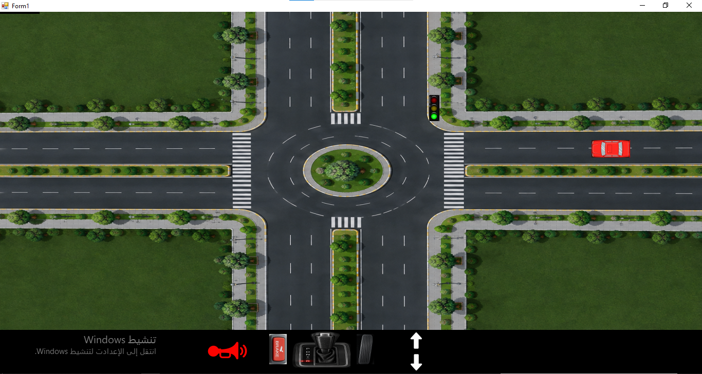
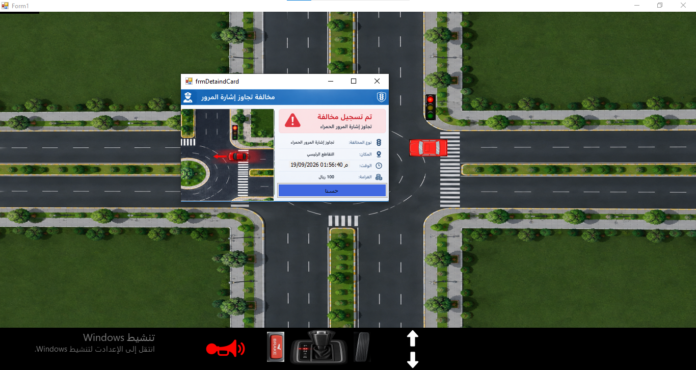

# 🚗 Event Drive

> A simple car simulation built to practice the Publisher-Subscriber Design Pattern using C# and .NET.

---

## 📌 About

Event Drive is a small educational project created after studying the Publisher-Subscriber Design Pattern in Course 20 of Dr. Mohammed Abu Hadood's Roadmap.

The main goal of the project is to apply Events, Subscribe, and Unsubscribe in a practical and simple scenario.

  

---

## ⚙️ How It Works

The project uses the Publisher-Subscriber concept for different actions:

- 🚗 Pressing a movement button creates a Subscribe.
- ⚡ The related Event is raised to perform the movement.
- 🔄 After the operation is completed, the subscription is removed using Unsubscribe.
- 🚦 Traffic violations also use the same Publisher-Subscriber concept through Events and Subscribers.

This keeps the different parts of the application relatively independent instead of creating direct dependencies between them.

---

## 📸 Screenshots

  

  

---

## 🎯 Purpose

This is not intended to be a complete game.

It is a small practical project created to reinforce my understanding of:

- Publisher-Subscriber Design Pattern
- Events
- Subscribe / Unsubscribe
- Event-driven programming
- Loose coupling between components

---

## 🛠️ Technologies

- C#
- .NET
- Windows Forms
- Publisher-Subscriber Design Pattern
- Events

---

## 👨‍💻 Author

Mohammed Abdullah Noman Qaid Mohammed

---

⭐ A small project, but an important step in turning what I learn into practical code.